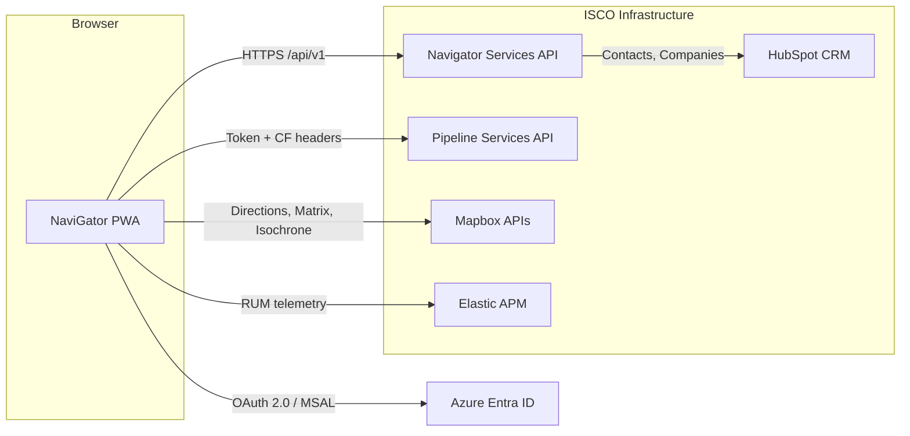

ISCO NaviGator is the route planning and itinerary execution tool for ISCO's regional sales and business managers. It is a Progressive Web App (PWA) built with React, TypeScript, Vite, and Tailwind CSS that runs in the browser and can be installed on mobile devices for field use.

The app is split across two repositories: the **PWA frontend** (`itinerary-builder`) and the **Navigator Services API** (`navigator_services`). The frontend calls the API at `https://navigator-services.isco-pipe.com` for all backend data and workflow operations.

## What NaviGator Does

NaviGator helps sales reps and managers:

- **Build multi-stop itineraries** by searching for customers, plants, projects, landfills, capital projects, and opportunities within a geographic area
- **Optimize routes** using Mapbox's directions, matrix, and optimization APIs to minimize drive time
- **Schedule visits** with automatic day-boundary handling, fixed-time appointments, and timezone awareness
- **Execute trips** by pulling assigned workflow activities from Pipeline, logging visits, recording contacts met, and closing out stops with required notes
- **Discover prospects** along a route corridor or within a drive-time isochrone polygon
- **Export itineraries** to Outlook (ICS), Google Maps, or PDF for sharing and offline reference
- **Track weather conditions** at stops to plan around severe weather alerts
- **View sales data** such as rolling 12-month revenue and open opportunity counts per customer

## Repositories and Hosts

| Repository | Role | Production Host |
| --- | --- | --- |
| `itinerary-builder` | React PWA frontend | `https://pathfinder.isco-pipe.com` |
| `navigator_services` | Backend API and workflow services | `https://navigator-services.isco-pipe.com` |

The frontend is served as a static build behind nginx. Development frontend deploys run a server-side blue-green deploy script that the deployment repository owns. See [Deployment](/navigator/deployment) for the full CI/CD flow.

## Architecture at a Glance

The PWA authenticates users through **Azure Entra ID (MSAL)** with Duo MFA. All API requests carry a Bearer token injected by the global fetch wrapper in `src/config/api.ts`. Production builds also send **Cloudflare Access service token headers** (`CF-Access-Client-Id` and `CF-Access-Client-Secret`) because the API sits behind Cloudflare Access.

## Key Capabilities Found in Code

The following features are implemented in the `itinerary-builder` source:

| Capability | Where It Lives |
| --- | --- |
| Itinerary building with drag-and-drop reordering | `src/components/StopsSidebar.tsx`, `src/components/ItineraryPanel.tsx` |
| Route optimization (Mapbox Optimization + Directions APIs) | `src/services/routeOptimizationService.ts`, `src/services/segmentOptimizationService.ts` |
| Geographic clustering for large stop sets | `src/services/clusterRoutingService.ts`, `src/services/clusteringEngine.ts` |
| Greedy time-window selection between fixed appointments | `src/services/greedySelectionEngine.ts` |
| Schedule calculation with day boundaries and timezone handling | `src/services/scheduleCalculator.ts` |
| Drive-time isochrone generation | `src/hooks/useIsochrone.ts`, `src/services/mapboxApiService.ts` |
| Route corridor search (buffered polygon along a route) | `src/services/routeCorridorService.ts`, `src/utils/cleanCorridor.ts` |
| Map rendering with 6 entity type layers, clustering, and spiderfier | `src/components/MapView.tsx`, `src/components/map/` |
| HubSpot contact and company search | `src/services/hubspotService.ts` |
| Weather lookup and alerts | `src/services/weatherService.ts` |
| Activity assignment to Pipeline workflow | `src/services/activitySeriesService.ts` |
| Assigned series pickup and execution | `src/components/AssignedSeriesTab.tsx`, `src/services/assignedSeriesService.ts` |
| Outlook/ICS, Google Maps, and PDF export | `src/services/exportService.ts` |
| Onboarding guided tour | `src/tour/onboardingTour.ts` |
| Elastic APM RUM instrumentation | `src/config/apm.ts`, `src/config/apmReact.tsx` |

## Data Sources

NaviGator queries several backends through the Navigator Services API:

- **Customers, Plants, Projects, Landfills, Capital Projects** from the ISCO geo index (Elasticsearch-backed polygon queries)
- **Opportunities and Quotes** from the CRM pipeline index
- **Sales Employees and Teams** from the directory service
- **Workflow Activities** from the Pipeline `wf_activity` and `wf_activity_series` tables
- **HubSpot Contacts and Companies** for meeting attendance logging
- **Weather data** from a third-party weather service proxied through Navigator Services
- **Mapbox** for geocoding, directions, travel time matrices, isochrones, and map tiles

## Authentication

Users sign in through **Azure Entra ID** via `@azure/msal-browser` and `@azure/msal-react`. The MSAL configuration is in `src/config/msalConfig.ts`:

- Client ID: `3fe6fd99-7c37-498e-8982-e20405b63d5c`
- Authority: `https://login.microsoftonline.com/266ee5f5-db91-4133-a62c-db7ade5302f3`
- Redirect URI: `window.location.origin`
- Token scopes: `api://3fe6fd99-7c37-498e-8982-e20405b63d5c/User.Read`

The global fetch wrapper in `src/config/api.ts` automatically injects the Bearer token for every request to `API_BASE_URL`. In production, it also adds Cloudflare Access headers when `VITE_CF_CLIENT_ID` and `VITE_CF_SECRET_ID` are set.

## PWA Behavior

NaviGator is configured as a PWA via `vite-plugin-pwa` in `vite.config.ts`:

- **Display mode**: `standalone` (no browser chrome)
- **Orientation**: `portrait-primary`
- **Icons**: `192.png` and `512.png`
- **Runtime caching**: Mapbox tiles and API responses are cached with a NetworkFirst strategy
- **Scope**: `.`
- **Start URL**: `.`

The service worker handles offline navigation by falling back to `index.html`, and API calls are explicitly excluded from the offline fallback.

## Explore the Navigator Docs

<CardGroup cols={2}>
  <Card title="User Guide" icon="map" href="/navigator/user-guide">
    How sales users plan and execute trips end to end.
  </Card>

  <Card title="App Setup" icon="wrench" href="/navigator/app-setup">
    Clone, configure, and run the PWA locally.
  </Card>

  <Card title="App Architecture" icon="code" href="/navigator/app-architecture">
    Code tour: hooks, services, components, and state flow.
  </Card>

  <Card title="Services API" icon="webhook" href="/navigator/services-api">
    Backend endpoints consumed by the PWA.
  </Card>

  <Card title="Services Setup" icon="server" href="/navigator/services-setup">
    How to run the Navigator Services backend locally.
  </Card>

  <Card title="Deployment" icon="rocket" href="/navigator/deployment">
    Blue-green Docker deploys and CI/CD pipeline.
  </Card>
</CardGroup>
