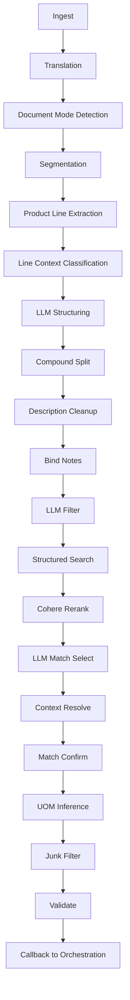

The Parrot matching pipeline transforms raw customer documents (emails, spreadsheets, PDFs, images) into structured quote lines with matched catalog parts. It is implemented as a LCEL-style chain of `Tool` subclasses in `chalicelib/pipeline/`, composed with the `|` operator in `PipelineRunner` (`chalicelib/pipeline/runner.py`).

<Warning>
  Several files in this repo contain committed secrets (API keys, DB passwords, tokens). Never commit values to the repo. Use local config or the team's secret store. Document setting names only.
</Warning>

## Execution Order

The pipeline runs the following stages in order. Progress percentages are reported via `ToolContext.on_progress` and mapped to orchestration stages (extraction, ocr, rerank) in `WorkerService._run_pipeline`.



---

## Stage 1: Ingestion (2-18%)

**Source modules:**

- `chalicelib/pipeline/ingest/email.py` — `EmailIngestionTool`
- `chalicelib/pipeline/ingest/document.py` — `MarkdownIngestionTool`
- `chalicelib/pipeline/ingest/spreadsheet.py` — `SpreadsheetIngestionTool`
- `chalicelib/pipeline/ingest/spreadsheet_race.py` — `SpreadsheetRaceIngestionTool`
- `chalicelib/pipeline/ingest/image_transcribe.py` — `transcribe_image`

**Input:** Raw file bytes (`.eml`, `.msg`, `.xlsx`, `.pdf`, `.png`, `.jpg`, etc.)

**Output:** `{"email": {"body_text": "...", "body_html": "...", "attachments": [...]}, "product_lines": [...], "spreadsheet_header": [...]}`

**Key rules:**

- **Emails:** Parses RFC822 and Outlook OLE2 (`.msg`) via `extract_msg`. Surfaces inline images as synthetic attachments when `QUOTE_BUILDER_IMAGE_INGEST=1`. Strips control chars and binary residue.
- **PDFs:** Runs a **bakeoff** between Cloudflare `tomarkdown`, LiteParse local, and LlamaParse OCR. Chooses the source that preserves the most product/quantity signal. If a UOM-column table is detected, recovers rows from `pypdfium2` word-rect coordinates for spreadsheet-mode downstream.
- **Spreadsheets:** Races native `openpyxl` parsing against Cloudflare markdown conversion. Selects by `m x n` shape dominance (`SpreadsheetRaceIngestionTool`).
- **Images:** Direct vision transcription via the configured OpenRouter model (default `google/gemini-3-flash-preview`). Empty transcript means the image is a logo/decoration and is discarded.

**Config flags:**

- `QUOTE_BUILDER_IMAGE_INGEST` — master switch for image ingestion (default `0`, set to `1` in dev)
- `QUOTE_BUILDER_ATTACHMENT_CONCURRENCY` — max concurrent attachment processing (default `4`)

---

## Stage 2: Translation (4-8%)

**Source module:** `chalicelib/pipeline/translate/language.py` — `TranslationTool`

**Input:** `email.body_text`

**Output:** `{"text": "...", "translated": true|false, "source_language": "en", "metric_conversions": ["200mm -> 8\"", ...]}`

**Key rules:**

- Detects language via LLM (`LANGUAGE_DETECT_PROMPT`). If non-English, translates while preserving part numbers, dimensions, units, and proper nouns.
- **Always** runs metric-to-imperial pipe-size conversion using the standard DN to NPS table (`_DN_SIZES`) and IPS/DIPS OD series lookups. Even English Canadian RFQs may use metric notation.
- Skips conversion for metric-native parts (electrofusion couplings) identified by `METRIC_NATIVE_RE`.

---

## Stage 3: Document Mode Detection (10-14%)

**Source module:** `chalicelib/pipeline/extract/classify/document.py` — `DocumentModeDetectionTool`

**Input:** Translated `body_text`

**Output:** `{"mode": "structured" | "unstructured", "score": 0..1, "signals": {...}}`

**Key rules:**

- Classifies as `unstructured` when: less than or equal to 2 lines with avg length greater than 180 chars, or product-line fraction less than 15% with avg length greater than 140, or fewer than 3 newlines with more than 600 total chars.
- Structured docs skip segmentation; unstructured docs proceed to LLM segmentation.

---

## Stage 4: Segmentation (14-20%)

**Source module:** `chalicelib/pipeline/extract/segment/text.py` — `LLMSegmentationTool`

**Input:** Unstructured `body_text`

**Output:** `{"lines": ["line1", "line2", ...], "mode": "llm" | "fallback"}`

**Key rules:**

- LLM splits paragraph blobs into discrete product-line strings (`SEGMENTATION_SYSTEM_PROMPT`).
- Fallback: regex split on newlines/semicolons/periods, with comma-split for lines greater than 180 chars.
- Skipped when `doc_mode == "structured"`.

---

## Stage 5: Product Line Extraction (20-29%)

**Source module:** `chalicelib/pipeline/extract/parse/lines.py` — `ProductLineExtractionTool`

**Input:** `email` dict (with `body_text` and optional `body_html`)

**Output:** `{"product_lines": [{"raw_line": "...", "description": "...", "quantity": N}, ...]}`

**Key rules:**

- **HTML table path:** If `body_html` contains a table with usable rows, extracts via `extract_email_table_lines` and returns row-level `product_lines` with `cells` and `table_header`.
- **Text path:** Splits body into lines, strips noise (signatures, addresses, greetings), applies regex `is_product_line` heuristics from `chalicelib/pipeline/extract/parse/patterns.py`.
- **Wall-of-text splitting:** Lines greater than 200 chars are judged by LLM (`WALL_JUDGE_PROMPT`) and split if needed (`WALL_SPLIT_PROMPT`).
- **Noise rescue:** Rejected lines are batch-reviewed by LLM (`NOISE_RESCUE_PROMPT`) to recover missed product lines.
- Quantity extracted via regex patterns for `qty`, `pcs`, `ea`, `each`, leading numbers.

---

## Stage 6: Line Context Classification (23-25%)

**Source module:** `chalicelib/pipeline/extract/structure/classify_context.py` — `LineContextClassifierTool`

**Input:** `product_lines` from extraction

**Output:** `{"product_lines": [...], "applies_to_directives": [...], "global_notes": "...", "context_provenance": [...]}`

**Key rules:**

- Classifies each line into: `product`, `section_header`, `spec_preamble`, `applies_to`, `procurement`, `noise`.
- **Atomizes** `applies_to` lines into `(target, meaning)` directives (e.g. "AFAS = 2" SW SADDLE").
- **Removes** `applies_to` and `procurement` lines from the product stream so they don't become phantom quote lines.
- `procurement` lines become `global_notes` (order-level meta like freight, urgency).
- Skipped for spreadsheet/table rows (they carry their own structure).

---

## Stage 7: LLM Structuring (25-28%)

**Source module:** `chalicelib/pipeline/extract/structure/lines.py` — `LLMLineStructurerTool`

**Input:** `product_lines` + optional `spreadsheet_header`

**Output:** `{"product_lines": [{"description": "...", "quantity": N, "uom": "...", "product_code": "...", "llm_confidence": 0.9}, ...]}`

**Key rules:**

- **Two modes:**
  - **Spreadsheet mode:** Per-row LLM calls with `header + cells` (`STRUCTURER_SPREADSHEET_PROMPT`). Batched in groups of 5.
  - **Text consolidation mode:** Bulk LLM call grouping fragments into proper items (`STRUCTURER_CONSOLIDATION_PROMPT`). Chunked to less than or equal to 25 lines per call, parallelized across 4 workers.
- **Document classification:** First 50 lines are classified as RFQ vs datasheet (`CLASSIFY_PROMPT`). Datasheets are skipped (return empty) with confirmation pass to avoid false positives.
- Loads real `uofmprice` vocabulary from Elasticsearch (`CatalogESClient.fetch_field_vocab_counts`) to coerce UOMs.

---

## Stage 8: Compound Split (28-29%) — DISABLED

**Source module:** `chalicelib/pipeline/extract/split/compounds.py` — `CompoundLineSplitterTool`

**Status:** Disabled as of #8668. The runner passes `llm_client=None`, so this step is a no-op passthrough.

**Reason:** Misfired on kit/pack descriptions (e.g. "BOLTPACK W/BOLTS, NUTS, AND WASHERS"), duplicating single SKUs. Genuine compound lines are left for sales to split manually.

---

## Stage 9: Description Cleanup (29-30%)

**Source module:** `chalicelib/pipeline/extract/cleanup/descriptions.py` — `DescriptionCleanupTool`

**Input:** `product_lines`

**Output:** `{"product_lines": [...]}` with cleaned descriptions

**Key rules:**

- **LLM batch cleanup** (`DESCRIPTION_CLEANUP_PROMPT`): Strips quantity expressions, collapses equal-size fittings (`10"-10"` becomes `10"`), strips leading zeros from sizes.
- **Deterministic metric conversion:** Converts `mlin` (metres linear) quantities to feet (ceil, never short).
- **Bare length/size inference:** Detects lines like `300ft 6in` and infers `PIPE` with dominant DR, material, and sizing standard from sibling context.

---

## Stage 10: Bind Notes (30-31%)

**Source module:** `chalicelib/pipeline/context/bind_notes.py` — `BindNotesTool`

**Input:** `product_lines` + `applies_to_directives`

**Output:** `{"product_lines": [...with bound_notes], "bind_provenance": [...]}`

**Key rules:**

- **Code-join (deterministic):** Distinctive code tokens (e.g. `AFAS`, `AF360002185`) are matched exactly against line descriptions. No LLM needed.
- **Type instructions (LLM):** For notes like "Fab Tees -> DR9 Beveled", deterministic keyword blocking narrows candidates, then one LLM `BIND_NOTES_PROMPT` pass confirms which lines genuinely match the product type.
- Bound notes are attached as `bound_notes` arrays on each line, with `via: "code"` or `via: "match"`.

---

## Stage 11: LLM Filter (30-44%)

**Source module:** `chalicelib/pipeline/filter/relevance/lines.py` — `LLMFilterTool`

**Input:** `product_lines`

**Output:** `{"product_lines": [...], "llm_filter_mode": "llm_batched" | "fallback", "llm_filter_batches": N}`

**Key rules:**

- Batches lines (default 5 per batch, configurable via `QUOTE_BUILDER_FILTER_BATCH_SIZE`) and asks LLM to return a boolean `keep` array (`RELEVANCE_FILTER_SYSTEM_PROMPT`).
- Drops totals, taxes, headers, shipping addresses.
- **Must-keep guard:** Lines matching bare length/size patterns (`_BARE_LENGTH_SIZE_RE`) are never dropped.
- Parallelized with `LLM_FILTER_CONCURRENCY` workers (default from `get_concurrency`).
- Fallback to deterministic regex when LLM is unavailable.

---

## Stage 12: Structured Search / Catalog Matching (50-80%)

**Source module:** `chalicelib/pipeline/match/search/structured.py` — `StructuredSearchTool`

**Input:** `product_lines`

**Output:** `{"quote_items": [{"product_line": {...}, "matched_parts": [...], "_extracted_specs": {...}}, ...]}`

**Key rules:**

- **Spec extraction:** One batched LLM call per chunk of less than or equal to 25 lines (`SPEC_EXTRACTION_PROMPT_TEMPLATE`), populated with real ES keyword vocabulary. Extracts: `nominal_size`, `nominal_size_2`, `dr`, `category_tier_1`, `category_tier_3`, `sizing_standard`, `connection_style`, `material`, `search_text`, `extra_attributes`.
- **Tiered Elasticsearch queries** (up to 4 per line, concurrent with 8 workers):
  1. `text+size+tier3` (strictest)
  2. `text+size` (broader)
  3. `text_only` (broadest)
  4. Boltpack-specific translation
- **Post-search enrichment:**
  - FM standard DR guard: drops DR values sourced from FM approval codes (e.g. `FM 1613-17` is not DR 17).
  - Metric size conversion for non-metric-native lines.
  - Bend/elbow defaults: bare "bend" becomes "elbow"; size less than or equal to 8" becomes molded, greater than or equal to 10" becomes fabricated.
  - Vocabulary aliases (e.g. `PPDI` becomes `POLY PRO ENCAPSULATED DI`, `HDPE PLATE` becomes `HDPE BLIND FLANGE`).
  - Reducer chain split (#8808): when no sellable single reducer exists for a size pair, discovers a chain of sellable reducers from the catalog itself.
- **Part code recovery:** Deterministic extraction of candidate codes, validated by LLM (`PART_CODE_VALIDATION_PROMPT`), attached as `part_codes` for corroboration.
- **Bound note search text augmentation:** Appends note meanings to `search_text` for retrieval (#8836).
- **Fallback:** If ES is not configured, falls back to `PartsMatchingTool` calling Pathfinder `product_lookup/search`.

**ES config:**

- `ES_URL` — default `https://10.1.0.37:9200`
- `ES_API_KEY` — required for auth
- `ES_INDEX` — default `catsy_data_scheduled_jobs`

---

## Stage 13: Cohere Rerank (81-82%)

**Source module:** `chalicelib/pipeline/match/rerank/candidates.py` — `CohereRerankTool`

**Input:** `quote_items` with `matched_parts`

**Output:** `{"quote_items": [...], "rerank_mode": "cohere" | "disabled", "rerank_errors": N}`

**Key rules:**

- Uses Cohere Rerank v2 API (`rerank-v3.5` by default) to reorder candidates per line.
- Rate-limited to 15 RPS by default (`RERANK_RPS` env var), with `RERANK_CONCURRENCY` workers (default 4).
- **Currently disabled in production** — the runner passes `effective_cohere = None`. Pathfinder handles reranking server-side.
- When disabled, candidates pass through with original ES scores.

---

## Stage 14: LLM Match Select (82-86%)

**Source module:** `chalicelib/pipeline/match/select/candidates.py` — `LLMMatchSelectionTool`

**Input:** `quote_items`

**Output:** `{"quote_items": [...with reordered matched_parts and _agent metadata]}`

**Key rules:**

- Per-line LLM call (`MATCH_SELECTION_PROMPT`) with:
  - Extracted description + specs
  - Customer part codes (from `part_codes`)
  - Bound notes (from `bound_notes`)
  - Full candidate list with catalog descriptions, specs, stocking levels, order popularity, SO/WO usage ratios
  - Relevant synonym rules from ES
- LLM returns `top_pick` (product code or `66666666` for no match) and `ranked_codes` (all candidates ordered).
- **Validation:** Checks for hallucinated codes, duplicate codes, code mismatches, and top_pick consistency. Auto-repairs single-char typos with edit-distance-1 correction.
- **Needs context:** When a critical spec (DR, sizing standard, connection style) is missing and candidates differ on it, returns `needs_context: true` with `missing_field` and `context_request` for the next stage.
- Concurrency: 20 workers by default.

---

## Stage 15: Context Resolve (86-88%)

**Source module:** `chalicelib/pipeline/match/resolve/context.py` — `ContextResolveTool`

**Input:** `quote_items` with `_needs_context`

**Output:** `{"quote_items": [...with resolved matches]}`

**Key rules:**

- Collects all lines tagged `_needs_context`.
- **Intelligent context search:** Finds resolved sibling lines that share the same `nominal_size` and have the missing field populated. Scores by size match (+100) and line proximity (+50/distance).
- **One LLM call per line** (`CONTEXT_ANSWER_AND_SELECT_PROMPT`) with:
  - Target description + question
  - Customer note (if bound) — **authoritative, outranks sibling inference**
  - Context lines (up to 8)
  - Full candidate list
- LLM answers the question, infers the missing value, and re-selects from candidates.
- **Two-pass:** First pass resolves what it can; second pass retries still-unresolved lines using newly resolved lines as additional context.
- Low-confidence answers are skipped (line remains unresolved).

---

## Stage 16: Match Confirm (88-90%)

**Source module:** `chalicelib/pipeline/match/confirm/__init__.py` — `MatchConfirmationTool`

**Input:** `quote_items`

**Output:** `{"quote_items": [...with _real_match annotation]}`

**Key rules:**

- **Final quality gate:** One LLM call per line (`MATCH_CONFIRM_PROMPT` for RFQ mode, `MATCH_CONFIRM_PROMPT_INVENTORY` for inventory mode).
- **Non-destructive annotation only:** Annotates `_real_match` as the top candidate's part number or `"NO-MATCH"`. Never modifies `matched_parts`.
- **Verdict YES when:** product type, size, material, and connection style match. Minor spec differences are acceptable if the core product is the same.
- **Verdict NO when:** wrong type, wrong size, wrong material family, wrong connection type, wrong sizing standard (with transition-fitting exceptions).
- Composite/transition products with two materials are handled correctly (e.g. HDPE body + stainless steel end is valid for "stainless MPT fitting").
- `66666666` sentinel codes are stripped from `matched_parts` after confirmation.
- Concurrency: 20 workers.

---

## Stage 17: UOM Inference (90-91%)

**Source module:** `chalicelib/pipeline/enrich/uom.py` — `UomInferenceTool`

**Input:** `quote_items`

**Output:** `{"quote_items": [...with inferred uom on product_line]}`

**Key rules:**

- Runs **after** matching so inferred UOM does not affect search.
- **Metric conversion first:** Converts metre quantities to feet (`_FT_PER_METRE = 3.28084`).
- **Text inference:** Detects explicit EA-style (`x5`, `10 EA`) or FT-style (`320'`, `440 ft`) patterns in source text.
- **Candidate consensus:** If text is ambiguous, votes on UOM from top 8 matched candidates. Requires greater than or equal to 70% agreement and greater than or equal to 2 votes.
- Only fills blank UOMs; never overwrites existing values.

---

## Stage 18: Junk Filter (90-92%)

**Source module:** `chalicelib/pipeline/filter/confidence/matches.py` — `LLMJunkFilterTool`

**Input:** `quote_items`

**Output:** `{"quote_items": [...], "junk_filter_mode": "llm_batched" | "disabled", "junk_filter_removed": N}`

**Key rules:**

- Only acts on lines whose **top match confidence is below threshold** (default 0.5, from `QUOTE_BUILDER_MIN_CONFIDENCE` / `QUOTE_BUILDER_LOW_CONF_THRESH`).
- Batches low-confidence lines and asks LLM (`CONFIDENCE_FILTER_SYSTEM_PROMPT`) to return a `remove` boolean array.
- **Fail-open:** When in doubt, keeps the line (`false`).
- When LLM is disabled, passes everything through (no-op).

---

## Stage 19: Validation (90-95%)

**Source module:** `chalicelib/pipeline/validate/results.py` — `ValidationTool`

**Input:** `quote_items`

**Output:** `{"valid": true|false, "issues": ["Item 3: non-positive quantity 0", ...]}`

**Key rules:**

- **Pass 1 — Coerce fields:**
  - `quantity`: must be positive integer. Fails on strings like `"5 EA"`.
  - `confidence`: must be float 0.0-1.0. Fails on strings like `"high"`.
- **LLM repair pass:** Collects failures and sends to `repair_fields` (`chalicelib/pipeline/validate/repair/fields.py`) with `REPAIR_PROMPT`. LLM returns corrected numeric values.
- **Pass 2 — Validate:** Checks quantity greater than 0, at least one matched part, and confidence greater than or equal to threshold.
- Validation issues are logged but do not halt the pipeline.

---

## Stage 20: Callback to Orchestration (96-100%)

**Source module:** `chalicelib/aws/orchestration_client.py` — `OrchestrationClient`

The worker reports results back to the Orchestration API via three endpoints:

| Endpoint | Purpose | Called When |
| --- | --- | --- |
| `POST /internal/jobs/{job_id}/status` | Progress heartbeat | Every stage transition |
| `POST /internal/jobs/{job_id}/complete` | Success + result lines | Pipeline finishes successfully |
| `POST /internal/jobs/{job_id}/fail` | Failure report | Pipeline throws exception |

**Dual-mode reporting:**

- **Dev mode** (`orchestration-api-url` empty): Writes progress/completion/failure directly to DynamoDB. The worker owns the record.
- **Prod mode** (`orchestration-api-url` configured): Sends S1/S2/S3 HTTP callbacks. Also writes result JSON to S3 (`results/{job_id}/result.json`) so the orchestrator can reference it.

**S2 line schema:**

```json
{
  "line_id": "L1",
  "line_number": 1,
  "raw_line": "6\" DR11 HDPE ELBOW",
  "source_files": ["quote.xlsx"],
  "source_refs": [],
  "qty": 10,
  "uom": "EA",
  "candidates": [
    {"isco_part_number": "12345678", "description": "6\" DR11 HDPE 90 ELBOW", "confidence": 0.95}
  ]
}
```

**Null UOM compatibility:** The worker emits `null` for absent UOM (model semantics). If the orchestrator rejects this with 422 (until ADO #8852 is deployed), the worker retries once with legacy `""` coercion.

---

## Progress Stage Mapping

Granular pipeline stages are mapped to the three orchestration stages for status reporting:

| Pipeline Stage | Orchestration Stage |
| --- | --- |
| extraction, translation, ocr, structuring, splitting, desc_cleanup, llm_filter | `extraction` |
| matching, reranking, match_selection, context_resolve, junk_filter, validation, cost | `rerank` |
| (ocr-specific) | `ocr` |

---

## Cost Tracking

Every LLM and API call is recorded in `ToolContext.cost` (`chalicelib/pipeline/cost.py`). The tracker accumulates:

- Per-step API calls, prompt/completion/total tokens
- Cohere search units
- Wall-clock latency per stage
- Dollar costs (resolved from OpenRouter generation IDs when `cost_mode=True`)

Cost summary is included in the final pipeline output as `cost_summary` (per-step) and `cost_totals` (aggregated).
