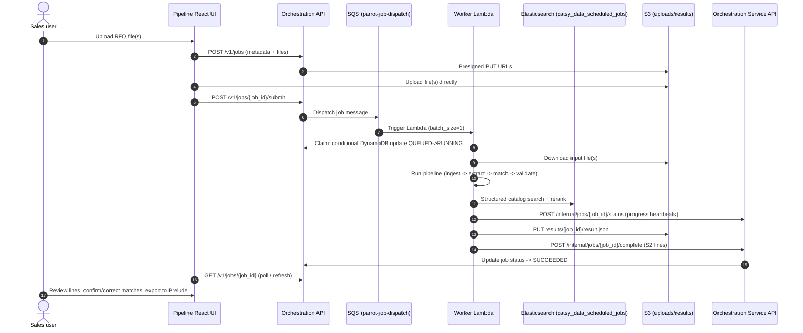

Parrot is ISCO's AI quote builder. Sales users upload a customer request for quote (PDF, spreadsheet, email, or image), and Parrot extracts the requested items, matches each one to ISCO catalog products, and returns lines that the team reviews and exports into Prelude.

## Components

| Component | Repository | Role |
| --- | --- | --- |
| UI | `iscopipe/pipeline` | `sales/parrot.php`, `sales/parrot_job_upload.php`, `sales/parrot_management.php`, and the React app in `react-src/components/quote_builder` |
| Orchestration API | `iscopipe/quote_builder_orchestration` | Chalice apps on AWS Lambda: a frontend contract for the UI and a service contract for worker callbacks |
| Worker | `iscopipe/quote_builder_aws` | SQS-triggered Chalice Lambda (`quote-builder-worker`) that runs the matching pipeline |

## End-to-end job lifecycle

## AWS resources by stage

### Orchestration layer (`quote_builder_orchestration`)

| Resource | Dev | Prod | Purpose |
| --- | --- | --- | --- |
| Lambda (frontend contract) | `orchestration-frontend-contract` | same | Public API for Pipeline UI |
| Lambda (service contract) | `orchestration-service-contract` | same | Internal API for worker callbacks |
| DynamoDB | `parrot-jobs-dev-v2` | `parrot-jobs-v2` | Single-table design: `job_id` PK, `sk` SK |
| SQS | `parrot-job-dispatch-dev` | `parrot-job-dispatch` | Worker trigger queue |
| S3 | Dev uploads bucket | Prod uploads bucket | Input files + result JSON |
| SSM prefix | `/parrot/dev/` | `/parrot/` | Config, API keys, DB names |

### Worker layer (`quote_builder_aws`)

| Resource | Dev | Prod | Purpose |
| --- | --- | --- | --- |
| Lambda | `quote-builder-worker` | same | SQS-triggered pipeline runner |
| DynamoDB | `parrot-jobs-dev-v2` | `parrot-jobs-v2` | Job claim + progress writes (dev mode) |
| S3 | Dev uploads/results bucket | Prod uploads/results bucket | File I/O |
| SSM prefix | `/parrot/dev/` | `/parrot/` | API keys, ES URL, Kore credentials |

## External services

| Service | Used by | How |
| --- | --- | --- |
| **OpenRouter** | Worker (`chalicelib/llm/openrouter.py`) | LLM calls for extraction, segmentation, filtering, match selection, context resolution, validation. Default model: `google/gemini-3-flash-preview`. |
| **Cohere** | Worker (`chalicelib/llm/cohere_rerank.py`) | Rerank v2 API for semantic re-scoring of Elasticsearch candidates. |
| **Cloudflare Workers AI** | Worker (`chalicelib/llm/cloudflare_markdown.py`) | Document-to-Markdown conversion for PDF, DOCX, images, and spreadsheets. |
| **Elasticsearch** | Worker (`chalicelib/pipeline/match/search/catalog_es.py`) | Structured bool queries against `catsy_data_scheduled_jobs` index for product catalog search. |
| **Pipeline Services API** | Worker + Orchestration | `https://pathfinder.isco-pipe.com:4443/api/v1/product_lookup/search` for part lookup; picklists for Prelude header fields. |
| **Kore API** | Orchestration frontend | Export confirmed lines to Prelude as quotes. |
| **Azure DevOps** | Orchestration frontend | Feedback submissions create work items in `ISCO-PIPE / Pipeline`. |

## Pipeline stages (what the worker does)

The worker chains decomposed tools in `chalicelib/pipeline/runner.py`. The exact order depends on file type:

1. **Ingest** — Cloudflare markdown (primary) or legacy parsers for `.xlsx`, `.eml`, `.msg`, `.txt`
2. **Translate** — Language detection and translation (non-English RFQs)
3. **Detect mode** — Structured vs unstructured document classification
4. **Segment** — LLM splits unstructured text into candidate lines
5. **Extract** — Regex gate + LLM noise rescue produces raw product lines
6. **Structure** — LLM normalizes lines into structured fields (description, qty, UOM)
7. **Filter** — LLM relevance check removes non-product lines
8. **Search** — Elasticsearch structured bool queries (tiered strategies: size+category, size, text-only)
9. **Rerank** — Cohere re-scores top candidates semantically
10. **Select** — LLM picks best match per line (+ escalation model on retry)
11. **Resolve context** — Cross-line disambiguation and second-pass for ambiguous matches
12. **Confirm** — Match confirmation with confidence boosting/squashing
13. **UOM inference** — Fills missing units of measure
14. **Junk filter** — Low-confidence removal
15. **Validate** — Schema and quality checks
16. **Normalize** — Rank-discount confidence normalization for S2 payload

## Access control

Parrot pages in Pipeline require the `PARROT_TESTER` (67) or `PARROT_TEAM` (73) role, defined in `inc/roles.php`. The React app receives `data-user_role_ids` from the PHP wrapper and gates debug features (like "Show API Results") to roles 1, 36, or 67.

## Explore Parrot

<CardGroup cols={2}>
  <Card title="User Guide" icon="book-open" href="/parrot/user-guide">
    How sales staff upload, review, and export quotes in Pipeline.
  </Card>

  <Card title="Matching Pipeline" icon="diagram-project" href="/parrot/matching-pipeline">
    Deep dive into the extraction, search, rerank, and match-selection stages.
  </Card>

  <Card title="Worker Setup" icon="server" href="/parrot/worker-setup">
    Clone, configure, and run the worker locally with uv and Python 3.12.
  </Card>

  <Card title="Orchestration Setup" icon="cloud" href="/parrot/orchestration-setup">
    Set up and deploy the orchestration layer (frontend + service contracts).
  </Card>

  <Card title="Orchestration API" icon="code" href="/parrot/orchestration-api">
    Complete endpoint reference for the public and internal APIs.
  </Card>

  <Card title="Testing & Evaluation" icon="vial" href="/parrot/testing-and-evaluation">
    Run the eval harness, frozen sets, and GUI against local fixtures.
  </Card>
</CardGroup>
